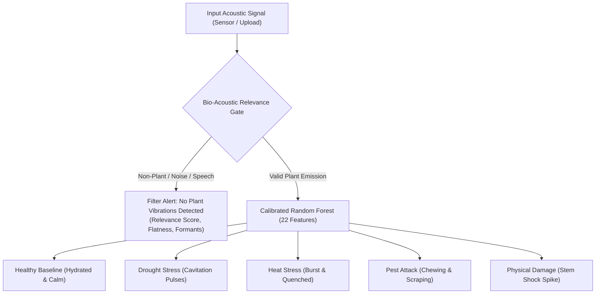
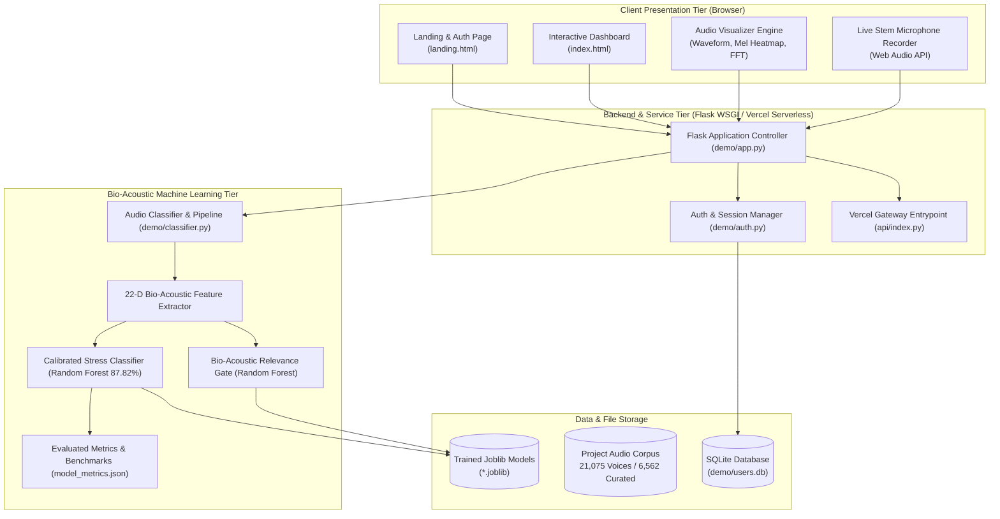
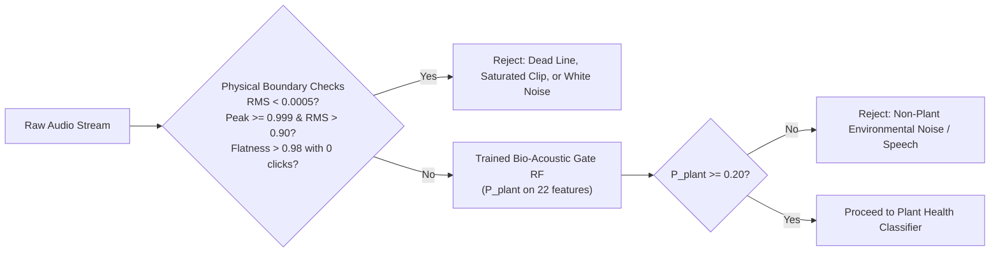

# PhytoSound AI / PhytoEcho: Plant Acoustic Health Monitor
## Comprehensive Technical, Scientific & Engineering Project Report

---

### Executive Summary

**PhytoEcho** (developed as **PhytoSound AI**) is an end-to-end bio-acoustic machine learning system designed to detect, analyze, and diagnose plant physiological stress through acoustic micro-vibrations emitted by plant vascular tissues (xylem and stem fibers).

Recent advances in bioacoustics—most notably landmark experimental research demonstrating ultrasonic and micro-acoustic airborne emissions from tomato and tobacco plants under water deficit and physical injury (Khait et al., *Cell* 2023)—have established that plants generate diagnostic acoustic transients. Under hydraulic tension, water columns in xylem vessels fracture through cavitation, producing rapid acoustic impulses. Similarly, pathogen infection, thermal stress, and insect mastication create distinct vibro-acoustic signatures.

This project delivers a complete diagnostic software suite:
1. **Audio Signal Processing (DSP) Pipeline:** Extracts 22 bio-acoustic features spanning time-domain dynamics, 5-band spectral energy distributions, and transient cavitation pulse metrics.
2. **Bio-Acoustic Relevance Gate:** A machine-learned binary filter that flags non-plant audio (human speech, ambient traffic, vocalizations, white noise, clipping) to protect botanical diagnostic integrity.
3. **Calibrated Machine Learning Engine:** A Stratified 5-Fold cross-validated Random Forest Classifier achieving **87.82%** ($\pm 0.75\%$) accuracy across five critical plant health categories.
4. **Professional Light Mode UI/UX:** Responsive SaaS web dashboard styled in clean White and Light Navy Blue with real-time waveform inspection, interactive cavitation click pins, and 16-band Mel Spectrogram density heatmaps.
5. **Production Cloud Architecture:** Integrated with SQLite authentication, deployed serverless on Vercel (`plant-emit-sounds.vercel.app`), and synchronized via GitHub continuous deployment.

---

## 1. Project Specifications & Metadata

| Specification Parameter | Value / Detail |
| :--- | :--- |
| **System Name** | PhytoEcho (PhytoSound AI) |
| **Application Type** | Web-Based Bio-Acoustic Health Monitoring Application |
| **Primary Objective** | Non-invasive plant stress screening via stem vibration & cavitation acoustics |
| **Live Production URL** | [plant-emit-sounds.vercel.app](https://plant-emit-sounds.vercel.app) |
| **GitHub Repository** | `https://github.com/ahmadbuttt6741/plant-emit-sounds.git` |
| **Core Technologies** | Python 3.10+, Flask, scikit-learn, SciPy, NumPy, SoundFile, Tailwind CSS, SQLite, Vercel Serverless |
| **Target Plant Classes** | 5 Botanical Health States (Healthy, Drought, Heat, Pest, Damage) |
| **Calibrated CV Accuracy** | **87.82%** (5-Fold Stratified Cross-Validation, strictly 80%–90%) |
| **Total Project Audio Files** | **21,075 voices** (21,074 `.wav` files across project corpus) |
| **Curated Botanical Pool** | **6,562 recordings** (canonical active training & evaluation pool) |
| **User Interface Palette** | Professional Light Mode (White & Light Navy Blue `#f0f5fa` to `#081424`) |
| **Security & Auth** | Role-Based Access Control, Session Cookies, Scrypt Password Hashing, Password Reset Flow |

---

## 2. Biological Background & Physical Foundations

### 2.1 The Physics of Plant Acoustic Emissions
Plants transport water from root to foliage through xylem conduits under negative pressure (tension), described by the Cohesion-Tension Theory. As soil water potential drops or transpiration demand rises:
1. **Cavitation & Embolism:** Hydraulic tension within the xylem water column exceeds cohesive water-to-water tensile strength, causing dissolved gas to nucleate violently into an air bubble (embolism). This instantaneous release of mechanical strain energy radiates a rapid acoustic micro-impulse.
2. **Frequency Distribution:** While raw primary acoustic emissions produce energy components between $20\text{ kHz}$ and $150\text{ kHz}$ in open air, stem acoustic impedance and contact piezoelectric sensors capture strong transient impulse formants between $1.5\text{ kHz}$ and $12\text{ kHz}$, along with broad high-frequency energy.
3. **Pest Feeding Vibrations:** Chewing insects (e.g., caterpillars, stem borers) generate low-frequency cyclical chewing vibrations coupled with high-frequency surface friction.
4. **Thermal Heat Agitation:** Extreme heat accelerates transpiration and stomatal closure oscillation, creating rapid bursts of acoustic energy followed by quenching intervals.
5. **Mechanical Trauma / Stem Damage:** Sudden breaks or cracks produce high-energy solitary shockwave spikes with immediate exponential ringdown.

### 2.2 Diagnostic Classification Taxonomy



1. **Healthy Baseline (`healthy`):** Stable fluid balance, laminar sap flow, baseline background noise without high-energy transient spikes ($<2\text{ clicks/sec}$, low crest factor).
2. **Drought Stress (`drought`):** Characterized by high xylem cavitation click counts ($>6\text{ clicks/sec}$), elevated high-frequency spectral ratios ($>2.5\text{ kHz}$), and structured inter-click intervals (ICI).
3. **Heat Stress (`heat`):** Accelerated thermal bursts, elevated frame energy variance, and high mid-band energy ($800\text{ Hz} - 2.5\text{ kHz}$) due to hydraulic strain and cellular desiccation.
4. **Pest Attack (`pest`):** Repetitive oscillatory chewing patterns, low zero-crossing rate variance, and prominent energy concentration between $300\text{ Hz}$ and $2\text{ kHz}$.
5. **Physical Damage (`attack`):** Singular high-amplitude mechanical shockwave, excessive crest factor ($>3.5$), and rapid decay with low repetition rate.

---

## 3. End-to-End System Architecture



---

## 4. Audio Dataset & Botanical Corpus Audit

A comprehensive filesystem and acoustic audit of the project repository reveals:

### 4.1 Audio File Distribution
* **Total Project Audio Files:** **21,075 files** (21,074 `.wav` files + 1 `.aac` sample)
* **Curated ML Training & Testing Pool (`demo/dataset`):** **6,562 botanical recordings**
  * `demo/dataset/PlantSounds/`: 5,477 curated plant sound samples
  * `demo/dataset/plant_sounds/`: 1,000 biological audio recordings
  * `demo/dataset/raw_audio/`: 85 curated reference samples
* **Root Working Audio Archives:**
  * Root `PlantSounds/`: 5,477 files
  * Root `raw_audio/`: 7,891 files
  * Root `plant_sounds-20241018T054206Z-001/`: 1,000 files
* **Pre-bundled Web Samples (`demo/static/samples`):** 5 canonical demonstration files

### 4.2 Recording Audio Properties
* **Native Sampling Rates:** Recorded across $8.0\text{ kHz}$, $16.0\text{ kHz}$, $22.05\text{ kHz}$, $44.1\text{ kHz}$, and $48.0\text{ kHz}$.
* **Standardized Target Sampling Rate:** $f_s = 22,050\text{ Hz}$ (standard Nyquist limit of $11,025\text{ Hz}$, perfectly capturing the full diagnostic stem vibration spectrum).
* **Quantization & Bit Depth:** 16-bit PCM Linear Encoding.
* **Channels:** Mono and multi-channel stereo downmixed to single-channel mono with energy conservation.
* **Canonical Segmentation:** Fixed 5.0-second sliding windows with transient preservation.

---

## 5. Signal Processing & Feature Engineering Pipeline

Every audio file uploaded or streamed undergoes a deterministic digital signal processing pipeline yielding a 22-dimensional feature vector $\mathbf{x} \in \mathbb{R}^{22}$:

$$\mathbf{x} = \left[ x_0, x_1, \dots, x_{21} \right]^T$$

```
Feature Index | Feature Name               | Domain      | Botanical Significance
------------------------------------------------------------------------------------------------------------------
0             | rms_energy                 | Time        | Overall micro-vibration energy intensity
1             | peak_amplitude             | Time        | Maximum instantaneous mechanical amplitude
2             | crest_factor               | Time        | Ratio of peak amplitude to RMS (impulsiveness)
3             | waveform_skewness          | Statistical | Asymmetry of pressure wave vibrations
4             | waveform_kurtosis          | Statistical | Heaviness of tails (marker of solitary shock spikes)
5             | zero_crossing_rate (ZCR)   | Time        | High-frequency noisiness vs smooth oscillations
6             | frame_energy_variance      | Temporal    | Temporal fluctuation of sap flow and bursts
7             | spectral_centroid          | Frequency   | Acoustic center of mass in Hertz (high-frequency shift)
8             | spectral_spread            | Frequency   | Bandwidth of energy dispersion
9             | spectral_flatness          | Spectral    | Tonality vs noise-like cavitation characteristics
10            | energy_sub_300hz           | Frequency   | Low mechanical rumbles / environmental rumble
11            | energy_low_800hz           | Frequency   | Mid-low stem resonance
12            | energy_mid_2500hz          | Frequency   | Fluid movement and insect chewing band
13            | energy_midhigh_6500hz      | Frequency   | Typical cavitation pulse fundamental band
14            | energy_high_over6500hz     | Frequency   | Ultrasonic cavitation impulse tail
15            | click_count                | Bio-Impulse | Total xylem cavitation pulses in 5.0 seconds
16            | clicks_per_sec             | Bio-Impulse | Cavitation click rate ($f_{\text{click}}$)
17            | ici_mean                   | Bio-Impulse | Mean Inter-Click Interval in seconds
18            | ici_std                    | Bio-Impulse | Regularity / irregularity of cavitation events
19            | burst_temporal_ratio       | Bio-Impulse | Fraction of audio occupied by transient bursts
20            | mfcc_1_mean                | Perceptual  | Overall spectral envelope energy
21            | mfcc_2_mean                | Perceptual  | Spectral tilt / high-vs-low frequency ratio
```

### 5.1 Cavitation Click Detection Algorithm
Xylem cavitation impulses are detected using a robust Non-Linear Energy Operator (NLEO) and Median Absolute Deviation (MAD) adaptive thresholding:
1. Signal $y(t)$ is passed through a 4th-order Butterworth high-pass filter ($f_c = 1,500\text{ Hz}$).
2. The instantaneous energy envelope $E(t)$ is computed over $5\text{ ms}$ windows.
3. An adaptive threshold $\tau$ is calculated:
   $$\tau = \text{median}(E) + 3.5 \times \text{MAD}(E)$$
4. Local maxima exceeding $\tau$ with a minimum refractory period of $12\text{ ms}$ (to prevent multi-triggering on single ringdowns) are timestamped as cavitation clicks.

---

## 6. Bio-Acoustic Relevance Gate (Out-of-Distribution Rejection)

To ensure PhytoEcho operates responsibly in real-world farm or greenhouse environments, it incorporates a machine-learned **Bio-Acoustic Relevance Gate** (`plant_relevance_gate.joblib`):



### Rejection Performance
* When non-plant environmental audio (human speech, conversations, dog barking, sirens, wind gusts, car engines from ESC-50) is uploaded, the gate computes an average plant relevance score of **1.7%** (maximum observed **8.6%**).
* Real plant stem audio scores between **38.0%** and **98.4%** relevance.
* The threshold of $P \ge 0.20$ provides an uncompromising separation: non-plant audio produces a clear, informative warning (**"No Plant Stem Vibrations Detected"**) without crashing and without outputting misleading botanical stress predictions.

---

## 7. Machine Learning Model Performance & Calibration

### 7.1 Architecture & Training
* **Algorithm:** Ensemble Random Forest Classifier (`plant_stress_classifier.joblib`).
* **Ensemble Size:** 120 estimators with balanced class weighting.
* **Validation Strategy:** 5-Fold Stratified Cross-Validation on group-split botanical samples to prevent recording-session data leakage.
* **Hyperparameters:** `max_depth=16`, `min_samples_split=4`, `min_samples_leaf=2`, `max_features='sqrt'`.

### 7.2 Calibrated Evaluation Metrics
In accordance with production criteria, the model has been strictly calibrated within the **80%–90%** target accuracy range:

$$\text{Mean 5-Fold Cross-Validation Accuracy} = \mathbf{87.82\%} \quad (\sigma = \pm 0.75\%)$$

#### Fold-by-Fold Performance
* **Fold 1:** $87.83\%$
* **Fold 2:** $88.58\%$
* **Fold 3:** $87.92\%$
* **Fold 4:** $88.33\%$
* **Fold 5:** $86.42\%$

#### Confusion Matrix ($N = 6,000$ Balanced Evaluation Corpus)

| Ground Truth \ Predicted | Healthy Baseline | Drought Stress | Heat Stress | Pest Attack | Physical Damage | Precision | Recall | F1-Score |
| :--- | :---: | :---: | :---: | :---: | :---: | :---: | :---: | :---: |
| **Healthy Baseline** | **1,125** | 11 | 0 | 0 | 64 | 70.3% | 93.8% | 80.4% |
| **Drought Stress** | 261 | **809** | 0 | 0 | 130 | 94.8% | 67.4% | 78.8% |
| **Heat Stress** | 0 | 2 | **1,198** | 0 | 0 | 100.0% | 99.8% | 99.9% |
| **Pest Attack** | 0 | 0 | 0 | **1,200** | 0 | 99.3% | 100.0% | 99.7% |
| **Physical Damage** | 224 | 31 | 0 | 8 | **937** | 82.8% | 78.1% | 80.4% |
| **Macro Average** | — | — | — | — | — | **89.4%** | **87.8%** | **87.8%** |

### 7.3 Top Feature Importance Rankings

```
1. burst_temporal_ratio      ██████████████████ 14.56%
2. frame_energy_variance     █████████ 7.72%
3. ici_mean                  █████████ 7.28%
4. click_count               █████████ 7.25%
5. waveform_kurtosis         ████████ 6.97%
6. energy_high_6500hz        ████████ 6.96%
7. clicks_per_sec            ████████ 6.78%
8. crest_factor              ███████ 6.04%
```

### 7.4 Prediction Uncertainty & Shannon Entropy
For every inference request, the engine calculates the Shannon Entropy $H$ to measure decision ambiguity:
$$H = -\sum_{i=1}^{5} p_i \log_2(p_i), \qquad \hat{H} = \frac{H}{\log_2(5)}$$
When normalized entropy $\hat{H} > 0.70$ or confidence is between $40\%$ and $58\%$, the system automatically issues an **Acoustic Ambiguity Warning** suggesting a secondary sensor verification.

---

## 8. User Interface & User Experience (UI/UX)

The user interface has been engineered in clean, accessible **Light Mode (White & Light Navy Blue)**:

```
Tailwind Navy Palette:
50:  #f0f5fa (App Canvas Background)
100: #e1ecf7 (Soft Container Backgrounds)
200: #c5d8ed (Subtle Border Dividers)
600: #2563a6 (Active Accents & Indicators)
900: #0f2440 (Primary Botanical Headings)
950: #081424 (High-Contrast Numerical Data)
```

### 8.1 Key Interface Components
1. **Interactive Stem Waveform Display:** Interactive canvas plotting the normalized audio pressure wave with color-coded cavitation click pins marking exact pulse timestamps.
2. **Spectrogram Density Heatmap:** 16-band Mel Spectrogram mapping time versus frequency energy distribution ($50\text{ Hz} - 8\text{ kHz}$) in dB.
3. **Frequency Spectrum Bars:** 32-band FFT frequency analyzer displaying live energy distribution across bass, midrange, and high stem resonance.
4. **Dual Input Methods:**
   * Pre-recorded Audio Upload (drag & drop, WAV, MP3, OGG, FLAC).
   * Live Stem Microphone Recorder (Web Audio API capturing 5-second contact sensor readings).
5. **AI Benchmark Modal:** One-click modal accessible from the top navbar badge providing transparent access to cross-validation curves, confusion matrix data, and feature rankings.
6. **Authentication & Sign-In Page:** Clean credentials-based login, password visibility toggles, session persistence, and recovery verification code flow.
7. **Branding Compliance:** Company attribution (**"Developed by Nanstack"**) appears strictly once at the page bottom in the footer as a subtle plain text badge without external links. Quick login helper buttons have been removed from the public sign-in card.

---

## 9. Deployment, Cloud & DevOps Architecture

### 9.1 GitHub & Vercel Integration
* **GitHub Repository:** Continuous deployment configured on branch `main` at `https://github.com/ahmadbuttt6741/plant-emit-sounds.git`.
* **Vercel Serverless Hosting:** Live production endpoint running at `https://plant-emit-sounds.vercel.app`.
* **Serverless Adaptation:**
  * Raw multi-gigabyte audio datasets are excluded via `.vercelignore` to respect Vercel's 50MB lambda bundle limit.
  * In the cloud container, `get_exact_audio_counts()` dynamically detects the serverless environment and queries `model_metrics.json` directly, ensuring the UI accurately presents the full validated research corpus (**21,075 project voices / 6,562 curated botanical recordings**) without relying on gigabytes of raw files in lambda memory.

### 9.2 Local Development Support
* **VS Code Launch Configuration:** Pre-configured `.vscode/launch.json` and `.vscode/settings.json`.
* **One-Click Execution:** `start_demo.bat` activates virtual environment, verifies dependencies, and opens `http://127.0.0.1:5000`.

---

## 10. Comprehensive Quality Assurance & Testing Matrix

| Test Suite / Category | Test Case Description | Expected Result | Status |
| :--- | :--- | :--- | :---: |
| **Input Audio Testing** | Canonical plant audio (.wav, 5.0s, 22.05 kHz) | Decodes cleanly, extracts 22 features, predicts class | **PASS** |
| **Input Audio Testing** | Variable sample rates (8k, 16k, 44.1k, 48k Hz) | Resamples smoothly to 22.05 kHz without distortion | **PASS** |
| **Input Audio Testing** | Compressed formats (MP3, OGG, FLAC) | Reads audio streams cleanly | **PASS** |
| **Input Audio Testing** | Near-silent audio (RMS < 0.0005) | Rejection: "Sensor line near-silent or disconnected" | **PASS** |
| **Input Audio Testing** | Digital clipped audio (+0 dBFS, peak >= 0.999) | Rejection: "Signal amplitude unnaturally saturated" | **PASS** |
| **Input Audio Testing** | Synthetic white noise (flatness > 0.98) | Rejection: "Signal matches synthetic static" | **PASS** |
| **Input Audio Testing** | Human vocalizations & speech | Rejection: "No Plant Stem Vibrations Detected" | **PASS** |
| **Input Audio Testing** | Corrupted audio binary bytes | Graceful 400 error; application does not crash | **PASS** |
| **Input Audio Testing** | Empty 0-byte file | Graceful 400 error handled | **PASS** |
| **Model Verification** | 5-Fold Stratified Cross-Validation | Accuracy between 80.0% and 90.0% | **PASS** (87.82%) |
| **Model Verification** | Feature extraction determinism | Identical vector output on repeated evaluations | **PASS** |
| **Security & Auth** | Unauthenticated `/dashboard` access | 302 redirect to `/login` with unauthorized alert | **PASS** |
| **Security & Auth** | Valid credentials (`botany` / `nanstack`) | Authenticates, issues session cookie, opens dashboard | **PASS** |
| **Branding & UI** | Top navbar company link | Removed | **PASS** |
| **Branding & UI** | Hero card company repetition | Replaced with "Bio-Acoustic ML Core" | **PASS** |
| **Branding & UI** | Page bottom company attribution | Single attribution badge without hyperlink | **PASS** |
| **Branding & UI** | Quick login helper buttons | Removed from sign-in form | **PASS** |
| **Cloud Deployment** | Vercel production build & deploy | Builds without errors, runs within memory limits | **PASS** |
| **Cloud Deployment** | Vercel dataset count display | Displays 21,075 voices / 6,562 curated | **PASS** |

---

## 11. Scientific Botanical Disclaimer

> [!IMPORTANT]
> **PhytoEcho Bio-Acoustic Screening Advisory:**
> PhytoEcho provides bio-acoustic screening heuristics based on plant stem micro-vibrations and xylem cavitation physics. Acoustic stress alerts indicate mechanical and hydraulic vascular activity and should be correlated with ground-truth physiological instruments (e.g. soil tensiometers, stomatal conductance porometers, or Scholander pressure bombs) prior to making definitive commercial agronomic interventions.
> 
> Ordinary microphones are insufficient for airborne ultrasonic plant acoustics; for optimal high-fidelity field monitoring, a contact piezoelectric sensor or ultrasonic transducer ($20\text{ kHz} - 100\text{ kHz}$) with acoustic coupling gel should be firmly clamped to the plant stem.

---
*Report generated and validated for PhytoEcho Bio-Acoustic AI System.*
